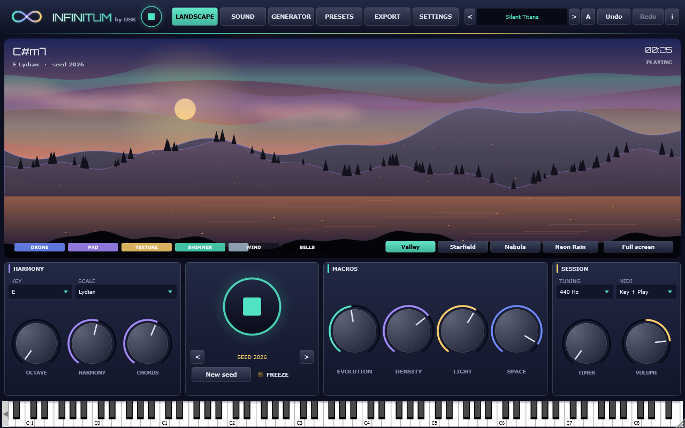

# Infinitum by DSK

**Generador de atmósferas infinitas: un paisaje sonoro que nunca se repite.**

Instrumento gratuito VST3 / AU / Standalone de [DSK Music](https://dskmusic.com) para ambient, cine y meditación.
Pulsa **Play** y seis capas (un drone que muta, un pad, una textura granular, shimmer, viento y campanas) entran y salen solas,
mientras la armonía, la luz y el espacio evolucionan despacio durante minutos u horas sin repetirse nunca.

## Funciones

- **Motor de paisaje vivo:** seis capas que tocan solas (Drone, Pad, Textura, Shimmer, Viento, Campanas). Cada una tiene Nivel,
  Presencia (cuánto tiempo está presente), Tono y Carácter; una modulación lenta que nunca se repite decide cuándo aparece.
- **Drone con Spectral Mutation:** armónicos que mutan y derivan como genes.
- **Textura granular y Shimmer en primer plano:** una nube de granos afinada a octavas y quintas, y una reverb con
  realimentación transpuesta (octava u octava + quinta).
- **Armonía en movimiento:** 12 escalas, cualquier tonalidad, de quintas abiertas a acordes de 7ª y 9ª, con cambios de acorde
  automáticos y conducción de voces.
- **Cuatro macros grandes:** Evolución, Densidad, Luz (de noche a mediodía) y Espacio (de una sala a una catedral infinita), y **Congelar**.
- **Botón Play / Stop** que además sigue el transporte de tu DAW. La evolución sale de una **semilla** y de la posición en la línea
  de tiempo: lo que exportas del DAW suena igual que lo que oíste, y la misma semilla siempre da el mismo viaje.
- **Exportación de audio largo:** de 1 minuto a 3 horas en **WAV, FLAC u OGG**, con fundido final (YouTube, meditación, estudio).
- **Temporizador de sesión** con fundidos de entrada y salida, y afinación a **432 Hz**.
- **Generador por estados de ánimo:** Cine, Ambient, Meditación, Oscuro y Sci-Fi (de tres a cinco variantes cada uno). Cada resultado se
  renderiza, se comprueba y se nivela antes de que lo oigas. Mutar, mezclar e historial de la sesión.
- **91 presets de fábrica** (incluidas noches de ciudad futurista bajo la lluvia y naves abandonadas), navegador con etiquetas, favoritos y valoraciones, comparación A/B, deshacer/rehacer, MIDI learn.
- **MIDI:** cambia la tonalidad desde tu teclado, toca notas encima, o ambas.
- **Cuatro paisajes animados** (Valle, Campo estelar, Nebulosa, Lluvia de neón) que reaccionan a cada capa, con **pantalla completa** y atajos de teclado.
- **Lluvia** (gotas y siseo) y un carácter de pad **analógico** de los 80, con vibrato lento y apertura del filtro en cada acorde.
- Escalable del 50 al 200 %, interfaz en **inglés y español** (automática o manual).

## Descarga

Próximamente en [dskmusic.com](https://dskmusic.com) y en las [Releases](../../releases) de este repositorio.

## Compilar

Ver la sección *Build from source* del [README en inglés](README.md).

## Licencia

GNU GPL v3 (ver [LICENSE](LICENSE)). Hecho con JUCE (GPLv3) y el VST3 SDK (MIT). Fuente Orbitron con licencia SIL OFL.
Partes del motor (Spectral Mutation, reverb FDN, shimmer) vienen de [Genesix by DSK](https://github.com/dskmusic/genesix-by-dsk).
