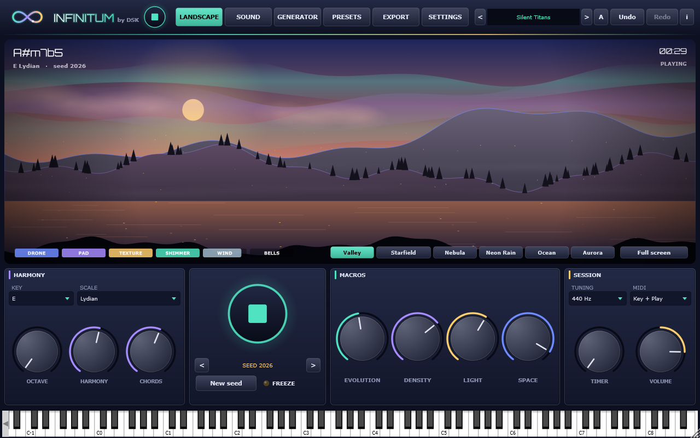
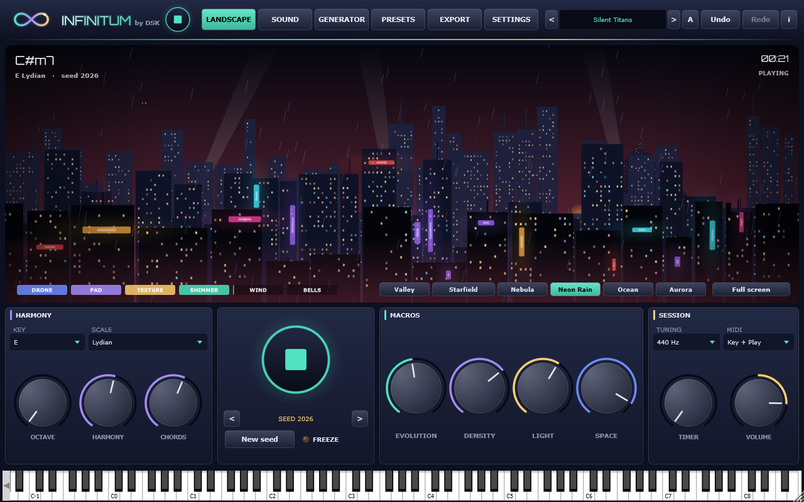
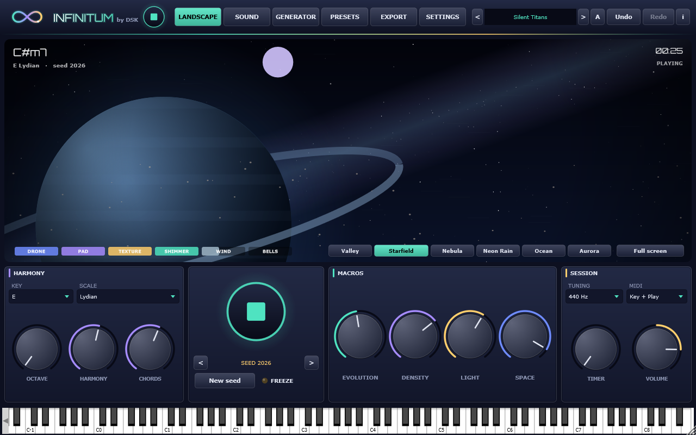
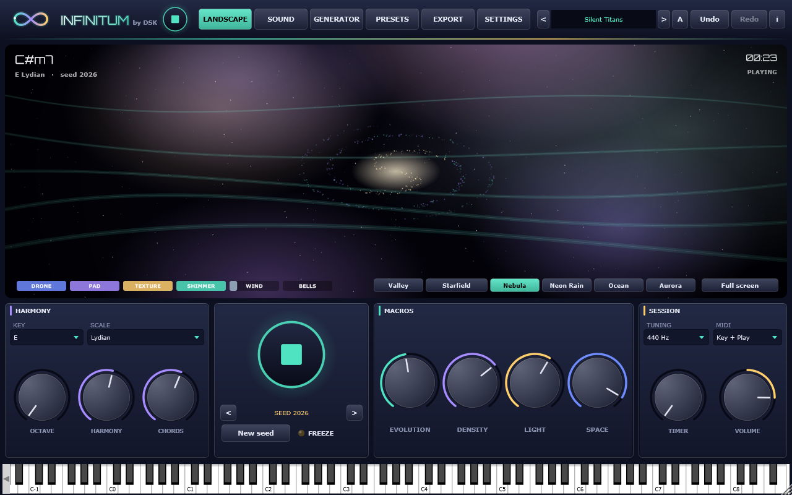
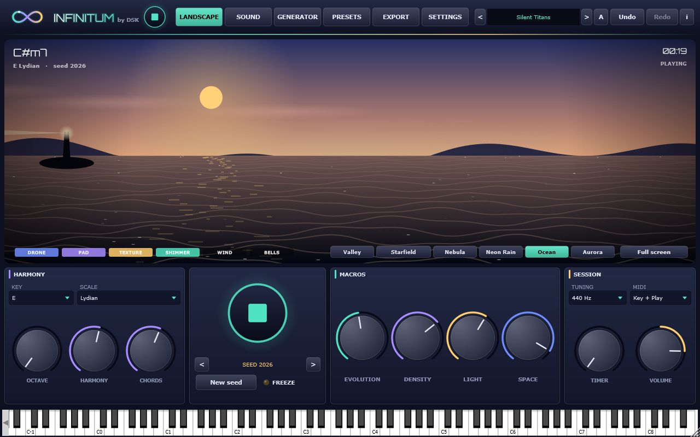
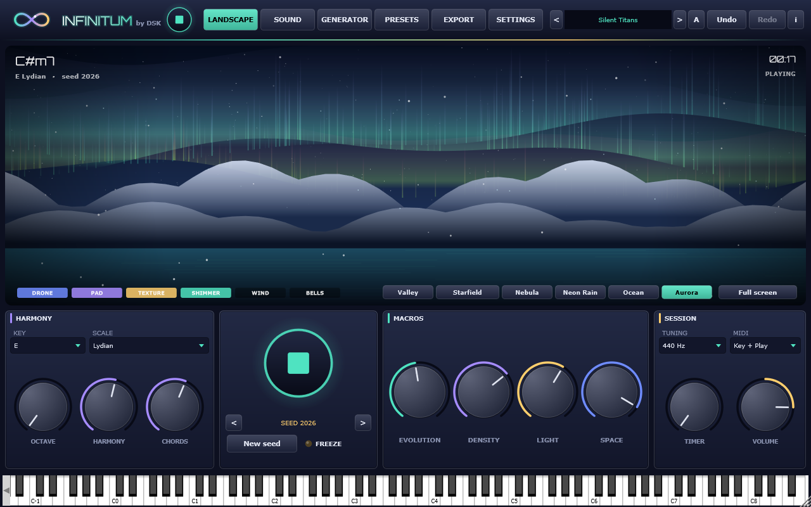
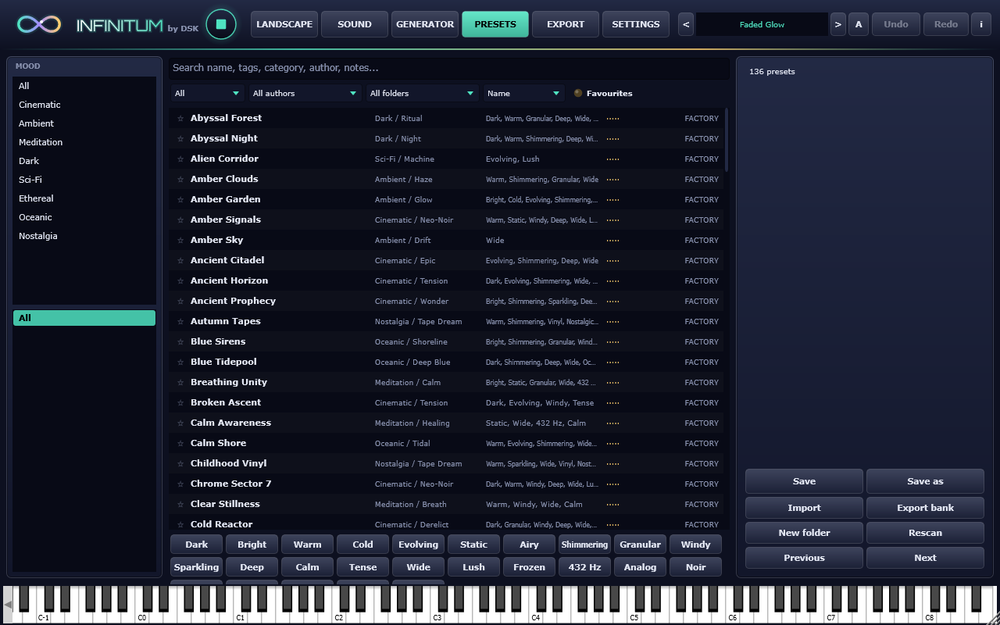
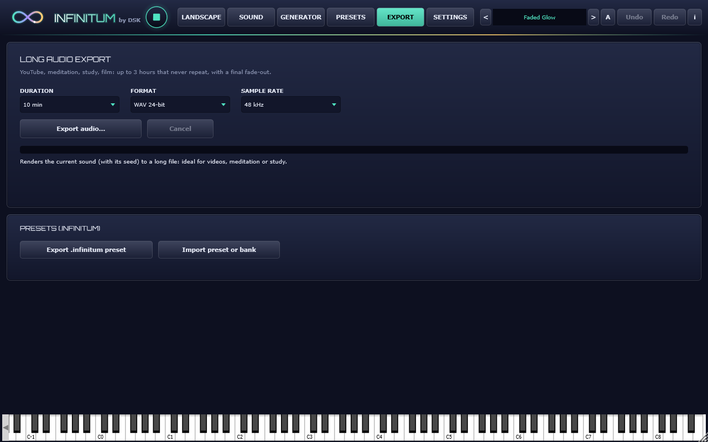

# Infinitum by DSK

**An endless soundscape generator — a landscape of sound that never repeats.**

Free VST3 / AU / Standalone instrument by [DSK Music](https://www.dskmusic.com/infinitum/) for ambient, film scoring and meditation.
**[Download](#download)** · [Product page](https://www.dskmusic.com/infinitum/) · [Latest release](https://github.com/dskmusic/infinitum-by-dsk/releases/latest)
Press **Play** and six layers — a mutating drone, a pad, a granular texture, shimmer, wind and bells — drift in and out on
their own, while harmony, light and space evolve slowly for minutes and hours without ever looping.



## Features

- **Living landscape engine:** six self-playing layers (Drone, Pad, Texture, Shimmer, Wind, Bells). Each one has Level,
  Presence (how much of the time it is there), Tone and Character; slow, never-repeating modulation decides when it appears.
- **Spectral Mutation drone:** harmonics that mutate and drift like genes.
- **Granular texture and Shimmer up front:** a grain cloud tuned to octaves and fifths, and a pitch-shifted feedback reverb
  (octave or octave + fifth).
- **Harmony that moves:** 12 scales, any key, from open fifths to 7th and 9th chords, with automatic chord changes and voice-leading.
- **Four big macros:** Evolution, Density, Light (night to midday) and Space (room to endless cathedral), plus **Freeze**.
- **Play / Stop** button that also follows your DAW transport. The evolution comes from a **seed** and the timeline position,
  so a DAW bounce sounds exactly like playback, and the same seed always gives the same journey.
- **Long audio export:** render 1 minute to 3 hours to **WAV, FLAC or OGG** with a final fade-out (YouTube, meditation, study).
- **Session timer** with fade-in and fade-out, **432 Hz** tuning option.
- **Mood generator:** 8 moods - Cinematic, Ambient, Meditation, Dark, Sci-Fi, Ethereal, Oceanic and Nostalgia (three to five sub-moods each), with every result rendered,
  checked and level-matched before you hear it. Mutate, blend and session history.
- **136 factory presets** (including rain-soaked neo-noir city nights and derelict spaceships), preset browser with tags, favourites and ratings, A/B compare, undo/redo, MIDI learn.
- **MIDI:** set the key from your keyboard, play notes on top, or both.
- **Six animated landscapes** (Valley, Starfield, Nebula, Neon Rain, Ocean, Aurora) that react to every layer, with a **full-screen mode** and keyboard shortcuts.
- **Noise generator** (pink, brown, white, ocean waves, vinyl crackle), an **analog** 80s pad with ensemble chorus, and bells that play short melodic phrases.
- Resizable 50–200 %, **English / Español** interface (automatic or manual).

| | |
|---|---|
|  |  |
|  |  |
|  |  |
|  |  |
|  |  |

## Download

**Product page:** https://www.dskmusic.com/infinitum/

| System | Recommended | Other formats |
|---|---|---|
| **Windows** 10/11 (64-bit) | [Installer (.exe)](https://github.com/dskmusic/infinitum-by-dsk/releases/latest/download/Infinitum-by-DSK-win-x64-setup.exe) | [VST3 (zip)](https://github.com/dskmusic/infinitum-by-dsk/releases/latest/download/Infinitum-by-DSK-win-x64-vst3.zip) · [Standalone (zip)](https://github.com/dskmusic/infinitum-by-dsk/releases/latest/download/Infinitum-by-DSK-win-x64-standalone.zip) |
| **macOS** 11+ (Universal: Apple Silicon + Intel) | [Installer (.pkg)](https://github.com/dskmusic/infinitum-by-dsk/releases/latest/download/Infinitum-by-DSK-macos-universal-installer.pkg) | [VST3](https://github.com/dskmusic/infinitum-by-dsk/releases/latest/download/Infinitum-by-DSK-macos-universal-vst3.zip) · [AU](https://github.com/dskmusic/infinitum-by-dsk/releases/latest/download/Infinitum-by-DSK-macos-universal-au.zip) · [Standalone](https://github.com/dskmusic/infinitum-by-dsk/releases/latest/download/Infinitum-by-DSK-macos-universal-standalone.zip) |
| **Linux** x86_64 | [VST3 (tar.gz)](https://github.com/dskmusic/infinitum-by-dsk/releases/latest/download/Infinitum-by-DSK-linux-x64-vst3.tar.gz) | [Standalone (tar.gz)](https://github.com/dskmusic/infinitum-by-dsk/releases/latest/download/Infinitum-by-DSK-linux-x64-standalone.tar.gz) |

All files and release notes: [latest release](https://github.com/dskmusic/infinitum-by-dsk/releases/latest) · checksums: [SHA256SUMS.txt](https://github.com/dskmusic/infinitum-by-dsk/releases/latest/download/SHA256SUMS.txt)

> The binaries are not code-signed. **Windows:** if SmartScreen appears, click *More info* → *Run anyway*.
> **macOS:** if the installer "can't be opened" or is "damaged", right-click it → *Open*, or run `xattr -dr com.apple.quarantine <file>` in Terminal.

### Install

- **Windows installer:** installs the VST3 to `C:\Program Files\Common Files\VST3` and the Standalone app.
- **macOS installer:** installs VST3, AU and the Standalone app. Rescan plugins in your DAW (Logic: AU Manager).
- **Manual:** copy `Infinitum by DSK.vst3` to your VST3 folder (`~/.vst3` on Linux).

### Quick start

1. Load **Infinitum** as an instrument and press **Play** (in the plugin, or your DAW's transport).
2. Turn **Evolution**, **Density**, **Light** and **Space**, pick a landscape, or press **GENERATE** on the Generator page.
3. Long render for videos or meditation: **Export** page → duration → WAV, FLAC or OGG.

Presets and settings are stored in `Documents/DSK Music/Infinitum/`.

## Build from source

Requirements: CMake 3.22+, a C++20 compiler (Visual Studio 2022, Xcode 15 or GCC 11+), Ninja. JUCE 8 is downloaded automatically.

```bash
./build_local.sh Release            # macOS / Linux
build_local.bat Release             # Windows
```

The tool `InfinitumTool` runs the unit tests (`InfinitumTool test`), renders presets and regenerates the factory bank.

## License

GNU GPL v3 (see [LICENSE](LICENSE)). Built with [JUCE](https://juce.com) (GPLv3) and the VST3 SDK (MIT).
The Orbitron font is under the SIL Open Font License (see `licenses/`).
Parts of the engine (Spectral Mutation, FDN reverb, shimmer) come from [Genesix by DSK](https://github.com/dskmusic/genesix-by-dsk).

Spanish: [README.es.md](README.es.md)
