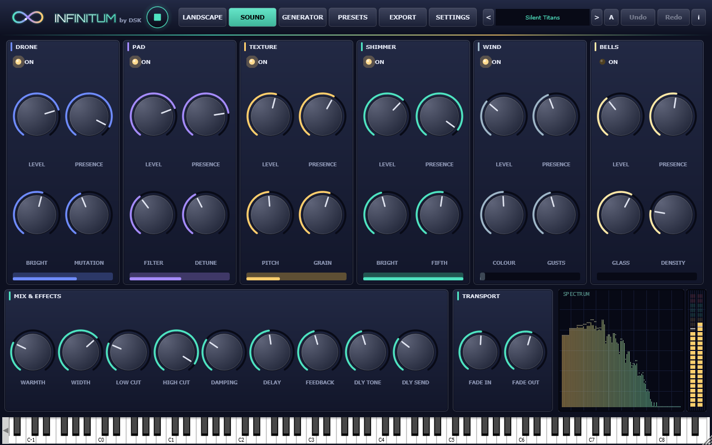
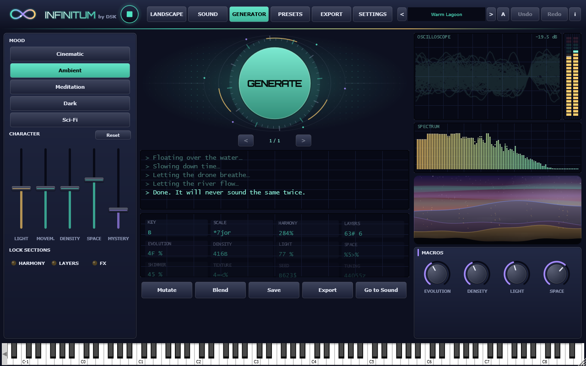

# Infinitum by DSK

**An endless soundscape generator — a landscape of sound that never repeats.**

Free VST3 / AU / Standalone instrument by [DSK Music](https://dskmusic.com) for ambient, film scoring and meditation.
Press **Play** and six layers — a mutating drone, a pad, a granular texture, shimmer, wind and bells — drift in and out on
their own, while harmony, light and space evolve slowly for minutes and hours without ever looping.


## Features

- **Living landscape engine:** six self-playing layers (Drone, Pad, Texture, Shimmer, Wind, Bells). Each one has Level,
  Presence (how much of the time it is there), Tone and Character; slow, never-repeating modulation decides when it appears.
- **Spectral Mutation drone:** harmonics that mutate and drift like genes.
- **Granular texture and Shimmer up front:** a grain cloud tuned to octaves and fifths, and a pitch-shifted feedback reverb
  (octave or octave + fifth).
- **Harmony that moves:** 12 scales, any key, from open fifths to 7th and 9th chords, with automatic chord changes and voice-leading.
- **Four big macros:** Evolution, Density, Light (night to midday) and Space (room to endless cathedral), plus **Freeze**.
- **Play / Stop** button that also follows your DAW transport. The evolution comes from a **seed** and the timeline position,
  so a DAW bounce sounds exactly like playback, and the same seed always gives the same journey.
- **Long audio export:** render 1 minute to 3 hours to **WAV, FLAC or OGG** with a final fade-out (YouTube, meditation, study).
- **Session timer** with fade-in and fade-out, **432 Hz** tuning option.
- **Mood generator:** Cinematic, Ambient, Meditation, Dark and Sci-Fi (three sub-moods each), with every result rendered,
  checked and level-matched before you hear it. Mutate, blend and session history.
- **75 factory presets**, preset browser with tags, favourites and ratings, A/B compare, undo/redo, MIDI learn.
- **MIDI:** set the key from your keyboard, play notes on top, or both.
- Resizable 50–200 %, **English / Español** interface (automatic or manual).

| | |
|---|---|
|  |  |
|  |  |

## Download

Coming soon on [dskmusic.com](https://dskmusic.com) and in the [Releases](../../releases) of this repository
(Windows installer and zips, macOS universal installer, Linux).

## Build from source

Requirements: CMake 3.22+, a C++20 compiler (Visual Studio 2022, Xcode 15 or GCC 11+), Ninja. JUCE 8 is downloaded automatically.

```bash
./build_local.sh Release            # macOS / Linux
build_local.bat Release             # Windows
```

The tool `InfinitumTool` runs the unit tests (`InfinitumTool test`), renders presets and regenerates the factory bank.

## License

GNU GPL v3 (see [LICENSE](LICENSE)). Built with [JUCE](https://juce.com) (GPLv3) and the VST3 SDK (MIT).
The Orbitron font is under the SIL Open Font License (see `licenses/`).
Parts of the engine (Spectral Mutation, FDN reverb, shimmer) come from [Genesix by DSK](https://github.com/dskmusic/genesix-by-dsk).

Spanish: [README.es.md](README.es.md)
